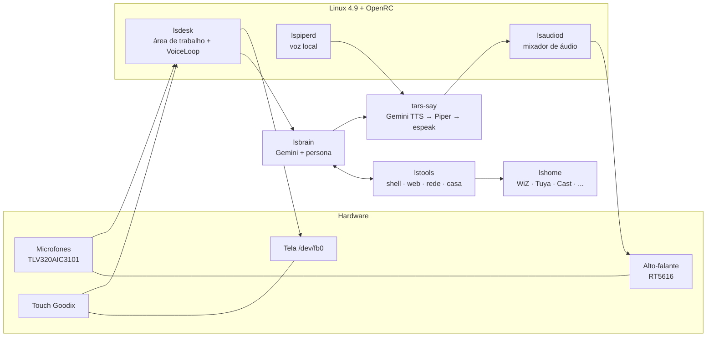

<div align="center">

```
 ┌──┐ ┌──┐ ┌──┐ ┌──┐
 │  │ │  │ │  │ │  │      T A R S   O S
 │  │ │  │ │  │ │  │
 │  │ │  │ │  │ │  │      Linux nativo no Echo Show 5, com um robô
 │  │ │  │ │  │ │  │      de fuzileiros navais morando na tela.
 └──┘ └──┘ └──┘ └──┘
   HUMOR 75%   ·   HONESTIDADE 90%   ·   EVERY SECOND COUNTS
```

**Sem Android. Sem Alexa. Com o TARS.**

[](LICENSE)
-orange)


[Instalar](docs/INSTALL.md) · [Arquitetura](docs/ARCHITECTURE.md) · [O TARS](docs/TARS.md) · [Hardware](docs/HARDWARE.md) · [Contribuir](CONTRIBUTING.md) · [Diário do projeto](docs/PROJECT-LOG.md)

</div>

> **TL;DR in English:** TarsOS turns the 1st-gen Amazon Echo Show 5 (MT8163, codename `checkers`) into a real Linux computer
> (postmarketOS/Alpine, kernel 4.9) with a touch desktop framebuffer UI and **TARS**, an Interstellar-inspired voice assistant
> (Portuguese-first, humor/honesty sliders, Gemini brain, shell/web/home-automation tools behind an on-screen confirmation
> gate). Everything here is Python + shell, no Android. The install needs a bootloader unlock via the public
> [amonet](https://github.com/bengris32/amonet) exploit. English summaries live at the top of each doc; contributions in
> English are welcome. Fan homage, not affiliated with Amazon or the film.

---

## O que é

O **TarsOS** é um sistema para o **Amazon Echo Show 5 de 1ª geração (2019, codinome `checkers`)** que troca o Android/Alexa da Amazon por um
**Linux de verdade** ([postmarketOS](https://postmarketos.org) sobre [Alpine](https://alpinelinux.org), kernel 4.9.77) e adiciona por cima:

- uma **área de trabalho própria** desenhada direto no framebuffer, com toque, teclado na tela, janelas e 18 apps;
- o **TARS**, um assistente de voz inspirado no robô de *Interestelar*: sarcástico, estoico, antifrágil, com **sliders de humor e honestidade**,
  que escuta sempre, fala, **usa ferramentas reais** (shell, web, rede, casa inteligente) e pede a sua confirmação na tela antes de qualquer coisa arriscada;
- integração com **AirPlay, Spotify, Chromecast, lâmpadas e tomadas inteligentes**, clima, notícias, timers e muito mais.

Tudo que roda no aparelho é **Python e shell** (mais o que o Alpine já traz). Não existe nenhum blob nosso: o kernel, o Wi-Fi e os drivers vêm do pacote do postmarketOS.

> *"Humor: 75%. Honestidade: 90%."* Os dois valores são ajustáveis por toque, por voz ("TARS, humor em noventa por cento") ou no `tars.json`.

## Como é

| | |
|---|---|
|  |  |
| **Início:** relógio, clima, 18 apps | **TARS:** monólito de 4 segmentos que respira, pensa e fala; chat; sliders de humor e honestidade |
|  |  |
| **Hoje:** o dia em segundos, reflexão estoica, intenção do dia | **Notícias:** RSS (G1, BBC, Tecnoblog, DW, esportes) |
|  |  |
| **Navegador** em modo leitura (sem JavaScript) com busca, resumo e leitura em voz alta | **Foco:** sessões de 15/25/50 min com anel de progresso |
|  |  |
| **Modo ocioso:** relógio âmbar, manchetes e tiradas do TARS | **Boot:** tela de boas-vindas desenhada pelo próprio sistema |

## O que já funciona

| Área | Estado |
|---|---|
| Boot do Linux (microloader do amonet), SSH, Wi-Fi (MT7668), NTP, serial USB | ✅ |
| Tela (framebuffer 480×960 girado), toque (Goodix), botões de volume, brilho automático (sensor de luz) | ✅ |
| Alto-falante (RT5616 + amplificador externo), fone P2 com troca automática | ✅ (fone: testado só com estados simulados) |
| Microfones (array TLV320AIC3101), escuta contínua com VAD | ✅ |
| **TARS**: chat, voz, ferramentas, confirmação na tela, memória, modos, botão **PARAR** | ✅ |
| Palavra de ativação: validação na nuvem (padrão) ou local com Vosk | ✅ nuvem · ⚠️ local precisa calibrar com sua voz |
| Voz: Gemini TTS, com **Piper** local neural de reserva (e espeak como último recurso) | ✅ |
| AirPlay (receptor), player e controles do Spotify (Web API), rádio online | ✅ |
| Casa inteligente local: WiZ, Yeelight, Shelly, Tasmota, Kasa, Chromecast/Nest, Tuya, Home Assistant | ✅ drivers · Tuya exige a chave local do aparelho |
| Navegador em modo leitura, notícias, clima, notas, timers/alarmes, foco, jogo da velha | ✅ |
| Bluetooth, GPU 3D, câmera, sensor de proximidade | ❌ o kernel 4.9 do aparelho não oferece (ver [HARDWARE](docs/HARDWARE.md)) |
| Spotify Connect (`librespot`) | ❌ o Spotify recusa a chave de áudio desta conta/dispositivo (usamos AirPlay + Web API) |

## Requisitos

**Hardware:** Amazon Echo Show 5 **1ª geração** (2019, `checkers`, MT8163). Os outros Echo **não** são compatíveis: a 2ª geração (`cronos`) é outro aparelho, com outro desbloqueio e outro porte.

**Desbloqueio:** o bootloader precisa estar desbloqueado com o exploit público [**amonet**](https://github.com/bengris32/amonet) (veja o guia no XDA: *"[UNLOCK][ROOT][TWRP][UNBRICK] Amazon Echo Show 5 1st Gen (2019) checkers"*).
**Este projeto não inclui nem redistribui o exploit.**

**No seu computador:** macOS ou Linux, Docker (ou uma VM Linux) para o [pmbootstrap](https://wiki.postmarketos.org/wiki/Pmbootstrap), `adb`/`fastboot`, Python 3, `ssh`. ~15 GB livres para o build.

**Contas e chaves (todas opcionais, só o que você quiser usar):**

| Serviço | Para quê | Custo |
|---|---|---|
| [Google AI Studio](https://aistudio.google.com/apikey) (Gemini) | cérebro e voz do TARS | plano gratuito (com cotas apertadas) |
| [Spotify Developer](https://developer.spotify.com/dashboard) | mostrar e controlar o que toca | grátis |
| [iot.tuya.com](https://iot.tuya.com) | chaves locais de tomadas/lâmpadas Tuya | grátis |

> ⚠️ **Risco real.** Mexer no bootloader pode **brickar** o aparelho de forma definitiva e anula a garantia. **Nunca grave as partições `lk`, `preloader`, `tee1` e `tee2`.**
> Leia o [guia de instalação](docs/INSTALL.md) inteiro antes de começar e faça backup de `boot` e `recovery`. Você é o único responsável pelo seu hardware.

## Instalação em uma página

O caminho completo, com comandos, está em **[docs/INSTALL.md](docs/INSTALL.md)**. O resumo:

1. **Desbloqueie** o Echo com o amonet (guia externo) e faça backup.
2. **Gere a imagem** do postmarketOS (`amazon-checkers`, OpenRC, `edge`) com o pmbootstrap (`build/Dockerfile` ajuda no macOS).
3. **Encurte o cmdline** do `boot.img` com [`tools/bootimg_cmdline.py`](tools/bootimg_cmdline.py): sem isso o aparelho trava no logo da Amazon (a explicação está em [docs/HARDWARE.md](docs/HARDWARE.md)).
4. **Grave** `boot` e `userdata` pelo fastboot liberado do amonet.
5. **Primeiro boot:** Wi-Fi e chave SSH pela serial USB (`tools/echosh.py`).
6. **Provisione e envie o TarsOS:**
   ```bash
   ssh root@<IP-do-Echo> 'sh -s' < tools/provision.sh      # pacotes e modelos (pede confirmação para cada download)
   TARSOS_HOST=<IP-do-Echo> tools/deploy.sh --all          # envia o TarsOS e ativa os serviços
   TARSOS_HOST=<IP-do-Echo> tools/set_gemini_key.sh        # grava a chave do Gemini (modo 600, nunca no chat)
   ```
7. Diga **"TARS"**.

> Ainda **não há imagem pronta** para baixar: o kernel e os drivers vêm do postmarketOS e o desbloqueio depende de você. Um script de build reproduzível é uma das [metas](#roadmap).

## Como funciona



- **Boot:** BootROM → LK (Amazon) → **microloader do amonet** → kernel 4.9.77 do postmarketOS → OpenRC. O desafio escondido foi o limite de 1024 caracteres do cmdline.
- **Tela:** não há `fbcon`, DRM nem X/Wayland. O `lsdesk` é o "servidor gráfico": compõe a tela com Pillow, grava no framebuffer e lê o toque pelo `evdev`.
- **Áudio:** o driver de áudio da MediaTek entra em *kernel panic* com escritas que não sejam múltiplas de 64 bytes, e o amplificador do alto-falante tem o controle **invertido**. O `lsaudiod` é o único dono do alto-falante e mistura tudo.
- **TARS:** microfone → detecção de fala (VAD) → porta de ativação (nuvem ou Vosk local) → Gemini com *function calling* → ferramentas → voz.

Detalhes em [docs/ARCHITECTURE.md](docs/ARCHITECTURE.md), [docs/TARS.md](docs/TARS.md) e [docs/HARDWARE.md](docs/HARDWARE.md).

## O TARS

> Fala curta, seca, em português do Brasil. Estoico: separa o que depende de você do que não depende. Antifrágil: erro é combustível, e ele sempre dá o próximo passo. Sarcástico, sem ferir.
> O lema, **"Every second counts"**, é bússola e não bordão: o código só o libera em poucas respostas.

- **Modos de estilo** por voz: padrão, militar, zen, cinema, poeta.
- **Memória:** "lembra que eu tomo café sem açúcar". **Nome:** "me chame de Cooper".
- **Segurança em 3 níveis:** *auto* (só leitura, como usuário comum), *confirmar* (modal SIM/NÃO na tela, 60 s) e *bloquear* (`sudo`, partições, segredos, `| sh`, reboot...). Tudo que as ferramentas devolvem é tratado como **dado não confiável** (defesa contra *prompt injection*).
- **Privacidade:** o áudio só sai do aparelho para a transcrição do Gemini quando passa pelo detector de fala; com `wake_mode: local` nada sai até o Vosk ouvir "TARS". O botão do microfone na tela desliga a escuta.
- Um botão vermelho **PARAR** aparece no dock sempre que o TARS fala ou trabalha.

## Estrutura do repositório

```
rootfs-overlay/                    arquivos que vão para o / do Echo (tar | ssh)
  etc/init.d/                      serviços OpenRC: lsaudiod, lsdesk, lsjack, lspiperd, airplay...
  etc/local.d/                     tarefas de boot (áudio, hora, USB serial, splash)
  usr/local/bin/                   lsaudiod, tars-say, audio-speaker, audio-mic, lsjack, tuya-sync, showos...
  usr/local/lib/luizinhoshowos/    o código Python (nome interno histórico do projeto)
    lsdesk.py   área de trabalho: apps, toque, teclado, VoiceLoop
    lsbrain.py  cérebro do TARS: persona, Gemini, memória, comandos locais
    lstools.py  ferramentas e a política de segurança
    lshome.py   casa inteligente local
    lsweb.py    navegador em modo leitura e RSS
    lsvoice.py  captura do microfone e VAD
    lswake.py   palavra de ativação local (Vosk)
    lspiper.py  lspiperd.py   voz local (Piper)
tools/                             lado do computador: deploy, bootimg_cmdline, provision, serial, chaves
build/Dockerfile                   ambiente do pmbootstrap para macOS
docs/                              instalação, arquitetura, TARS, hardware, diário, imagens
```

> **Sobre os nomes `luizinhoshowos`:** o projeto nasceu com o nome *LuizinhoShowOS* e foi renomeado para **TarsOS**. Os caminhos internos (`/etc/luizinhoshowos`, `/var/lib/luizinhoshowos`, ...) ficaram como estavam para não quebrar dados e chaves.

## Roadmap

- [ ] **Build reproduzível** da imagem (script que roda o pmbootstrap, aplica o cmdline e empacota o overlay)
- [ ] Palavra de ativação local calibrada e distribuída (modelo "TARS" próprio, em vez do Vosk)
- [ ] Teste do `lsjack` com fone real e calibração do brilho automático
- [ ] Drivers de Hue e Matter; mais fontes de notícias; i18n (inglês)
- [ ] Voz local mais rápida (modelo Piper menor, quantizado) e cache de frases comuns
- [ ] Suporte a outros Echo (Show 5 2ª geração, Echo Spot) com a mesma base de software
- [ ] Kernel próprio com `fbcon`, `/dev/mem` e Bluetooth (longo prazo)

Veja as [issues](../../issues) e o [guia de contribuição](CONTRIBUTING.md).

## Contribuir

Todo mundo é bem-vindo: quem tem um Echo Show 5, quem só lê código, quem escreve documentação, quem testa em outro aparelho. O [CONTRIBUTING.md](CONTRIBUTING.md) explica como montar o ambiente,
como testar sem o aparelho, as regras de segurança e o checklist de PR. Para vulnerabilidades, veja o [SECURITY.md](SECURITY.md).

## Créditos

TarsOS é montado sobre ombros gigantes:

- **[amonet](https://github.com/bengris32/amonet)** (Rortiz2, k4y0z, bengris32, xyz e quem contribuiu): o exploit que abriu o aparelho.
- **[postmarketOS](https://postmarketos.org)** e **[Alpine Linux](https://alpinelinux.org)**: o porte `amazon-checkers`, o kernel, o Wi-Fi e a base inteira. Veja a [página do aparelho na wiki](https://wiki.postmarketos.org/wiki/Amazon_Echo_Show_5_(amazon-checkers)).
- **[Vosk](https://alphacephei.com/vosk/)** (reconhecimento local), **[Piper](https://github.com/OHF-Voice/piper1-gpl)** (voz local), **[Google Gemini](https://ai.google.dev)** (cérebro e voz na nuvem).
- **[shairport-sync](https://github.com/mikebrady/shairport-sync)**, **[pychromecast](https://github.com/home-assistant-libs/pychromecast)**, **[tinytuya](https://github.com/jasonacox/tinytuya)**, **[Pillow](https://python-pillow.org)**, **[pyte](https://github.com/selectel/pyte)**, **[python-evdev](https://github.com/gvalkov/python-evdev)**, fontes DejaVu.
- **[Open-Meteo](https://open-meteo.com)**: dados do clima (CC BY 4.0, uso gratuito não comercial). *Weather data by Open-Meteo.com.*
- O **TARS** é uma homenagem de fã ao robô do filme *Interestelar* (2014). Os sliders de humor e honestidade são a melhor ideia do roteiro.

## Aviso legal

TarsOS é um projeto independente e **não é afiliado, patrocinado nem endossado** pela Amazon, pela Warner Bros., pela Legendary, pela Syncopy ou por qualquer dono dos direitos de *Interestelar*.
"Amazon", "Echo", "Echo Show" e "Alexa" são marcas da Amazon.com, Inc., usadas só para identificar o hardware. O nome e o conceito do TARS pertencem aos seus donos; este repositório **não contém**
nenhum material do filme. Modificar o bootloader pode danificar o aparelho de forma permanente e anula a garantia: **use por sua conta e risco**, sem qualquer garantia (veja a [licença](LICENSE)).

## Licença

[Apache License 2.0](LICENSE), com `SPDX-License-Identifier: Apache-2.0` em cada arquivo de código. O arquivo [NOTICE](NOTICE) lista os componentes de terceiros e as respectivas licenças: eles **não** são redistribuídos aqui e mantêm os próprios termos, e as vozes e os modelos baixados pelo `provision.sh` também (confira a ficha de cada um).

---

<div align="center">

*Every second counts.*

</div>
